<p align="center">
  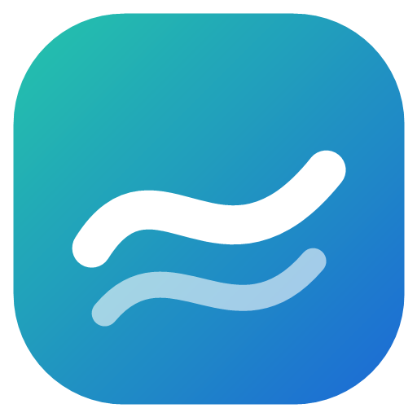
</p>

<h1 align="center">Drift</h1>

<p align="center">
  A calm, fast browser for Windows, Linux and Android.<br>
  Tabs down the side, a built-in ad blocker, and nothing in the way.
</p>

<p align="center">
  <a href="https://browser.lompendans.com/"><b>Download</b></a> ·
  <a href="https://github.com/lompendans/drift/releases/latest">Latest release</a> ·
  <a href="#install">Install</a> ·
  <a href="#build-it-yourself">Build it yourself</a>
</p>

<p align="center">
  <a href="https://github.com/lompendans/drift/releases/latest"></a>
  
  <a href="LICENSE"></a>
</p>

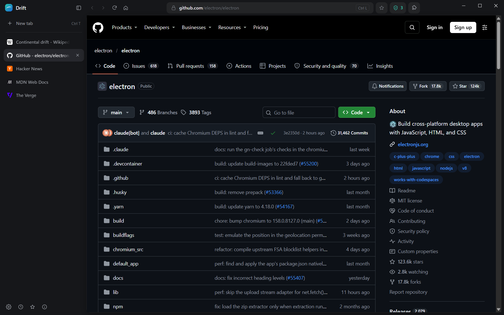

## What's in it

- **Tabs down the side.** Long titles stay readable. Drag to reorder, collapse the sidebar with <kbd>Ctrl</kbd>+<kbd>B</kbd>, and flip between recent tabs with <kbd>Ctrl</kbd>+<kbd>Tab</kbd>, the way <kbd>Alt</kbd>+<kbd>Tab</kbd> works. Tabs restored at startup sleep until you open them.
- **Ads and trackers blocked, built in.** Drift reads the same filter lists as uBlock Origin (uBlock filters, EasyList, EasyPrivacy, annoyances, badware) with its own filter engine: about 230,000 rules, including element hiding. Pages on the badware list are stopped before they open. One click turns blocking off for a site.
- **One box for everything.** <kbd>Ctrl</kbd>+<kbd>L</kbd> searches the web, your history, your bookmarks and your open tabs at once.
- **A start page that's yours.** Pin up to 12 shortcuts, rename them, drag them into order, or let Drift show the sites you visit most. Hide the clock or the shortcuts if you like a quieter page.
- **Make it look right.** Light or dark, six accent colors, a compact tab list, and Settings that keep it all in one place.
- **English and Türkçe.** Drift follows your computer's or phone's language, or pick one in Settings.
- **Bookmarks, and bring yours.** Star a page with <kbd>Ctrl</kbd>+<kbd>D</kbd>. Import bookmarks and history from Chrome, Edge, Firefox, Brave, Opera, Vivaldi or Chromium, even while that browser is open.
- **Chrome extensions.** Add them from the Chrome Web Store or Edge Add-ons, pin them to the toolbar and open their pop-ups.
- **Polite prompts.** Camera, microphone, location and notification requests appear in a slim bar above the page. Page dialogs, sign-in boxes, notifications, the right-click menu and the screen-sharing picker are all Drift's own.
- **Downloads you can see.** A progress ring in the toolbar and a list with pause, resume and "show in folder" (<kbd>Ctrl</kbd>+<kbd>J</kbd>).
- **Updates itself** from this repository's releases, checking each file against the SHA-256 checksum GitHub publishes.
- **Private by default.** No account, no analytics, no Drift server. See [Privacy](#privacy).

| | |
|---|---|
| 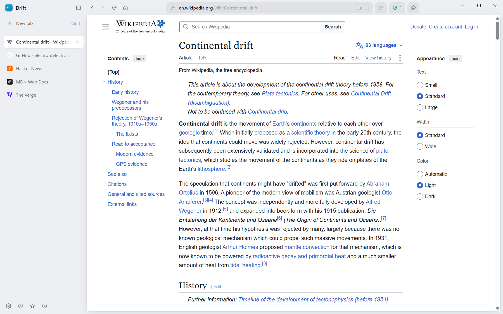 | 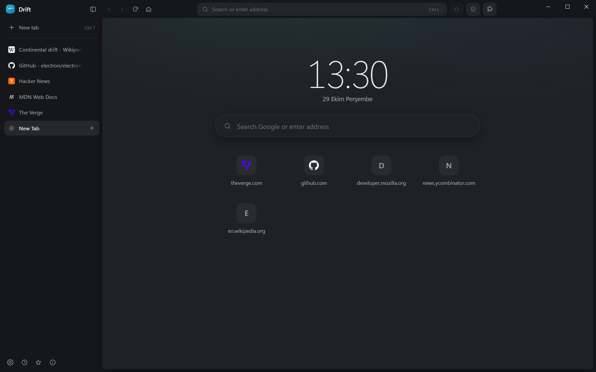 |
| Light mode follows your system, or pick one in Settings | The start page: search, the time, and your most visited sites |
| 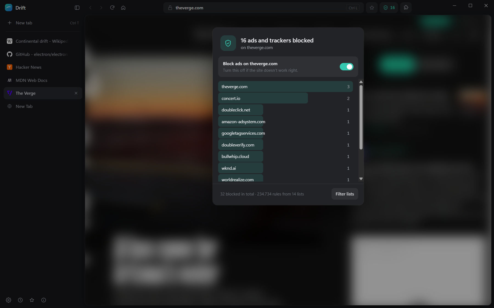 | 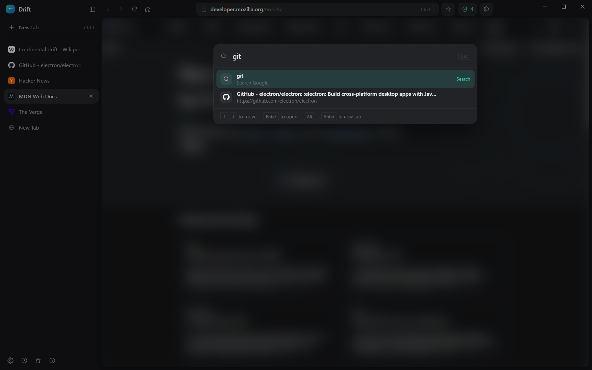 |
| What was blocked on this page, and a switch for the site | One box for the web, history, bookmarks and open tabs |
| 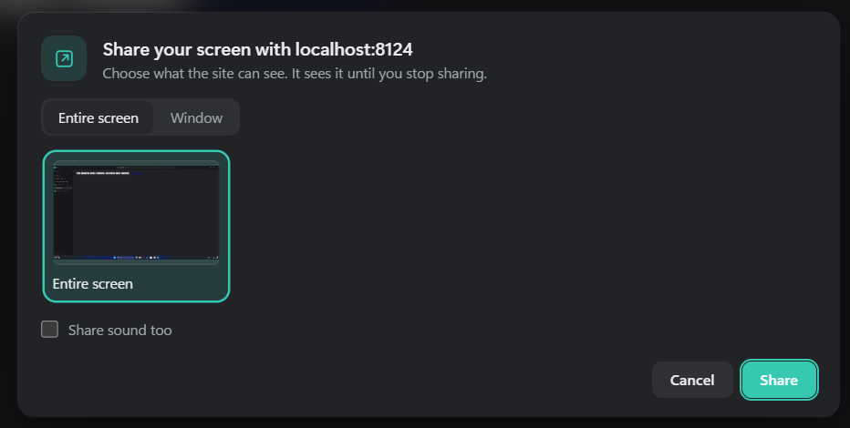 | 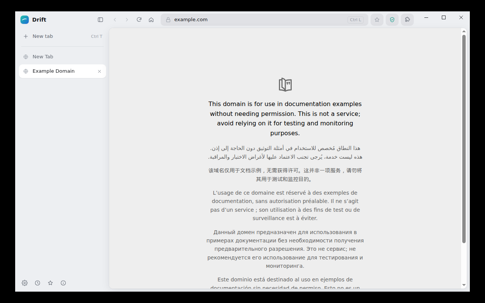 |
| Pick exactly what a site sees when it shares your screen | The same Drift on Linux (Ubuntu 24.04) |

<p align="center">
  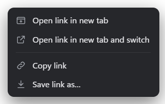
  &nbsp;
  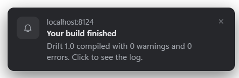
</p>

### On Android

The same Drift on your phone: the address bar at the bottom where your thumb is, a tab grid, the same ad blocker and filter lists, and the same calm design.

<p align="center">
  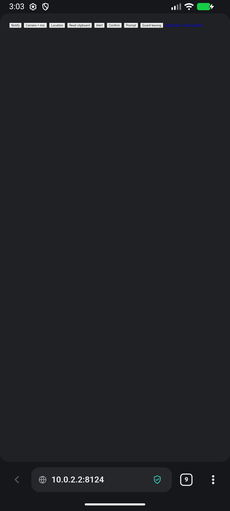
  
  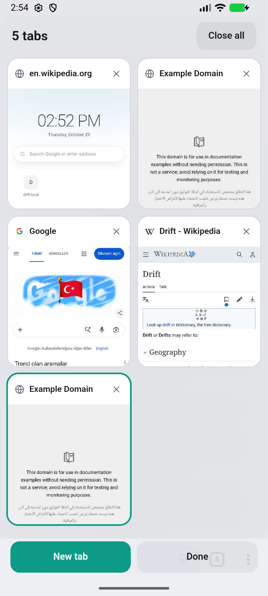
  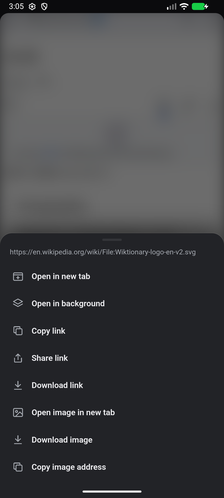
</p>

## Install

### Windows

1. Download **[DriftSetup.exe](https://github.com/lompendans/drift/releases/latest/download/DriftSetup.exe)** (about 160 MB).
2. Open it. If Windows shows "Windows protected your PC", choose **More info → Run anyway**. That happens for apps that aren't signed with a paid certificate.
3. Click **Install**. No administrator rights are needed: Drift installs for your user account in `%LocalAppData%\Programs\Drift`, with a Start menu shortcut (and a desktop one if you tick the box).

Prefer not to install? Unzip **[Drift-portable.zip](https://github.com/lompendans/drift/releases/latest/download/Drift-portable.zip)** anywhere and run `Drift.exe`. It updates itself in place too.

Works on Windows 10 and 11 (64-bit), and on Windows on ARM through its x64 emulation.

### Linux

One command, for any 64-bit (x86_64) distribution:

```sh
curl -fsSL https://lompendans.github.io/drift/install.sh | sh
```

- On **Ubuntu, Debian, Mint** and other apt-based systems it installs the `.deb` with apt (it asks for your password once), so Drift shows up in your apps menu and as `drift` in a terminal.
- On **everything else** (Fedora, Arch, openSUSE…) it puts the AppImage in `~/.local/share/drift`, links it as `~/.local/bin/drift`, and adds a menu entry. The AppImage updates itself.
- Add `-s -- --appimage` to get the AppImage on an apt system too, or `-s -- --uninstall` to remove Drift:

  ```sh
  curl -fsSL https://lompendans.github.io/drift/install.sh | sh -s -- --uninstall
  ```

The [script](install.sh) is short; read it before you run it if you like.

Or download a file yourself:

| File | For |
|---|---|
| [`drift_amd64.deb`](https://github.com/lompendans/drift/releases/latest/download/drift_amd64.deb) | Ubuntu 22.04+, Debian 12+, Mint 21+: `sudo apt install ./drift_amd64.deb` |
| [`Drift-x86_64.AppImage`](https://github.com/lompendans/drift/releases/latest/download/Drift-x86_64.AppImage) | Any distribution: `chmod +x Drift-x86_64.AppImage && ./Drift-x86_64.AppImage` (needs FUSE 2: `libfuse2`, `fuse-libs` or `fuse2`) |
| [`Drift-linux-x64.tar.gz`](https://github.com/lompendans/drift/releases/latest/download/Drift-linux-x64.tar.gz) | Plain files: unpack and run `drift/drift` |

### Android

1. On your phone, download **[Drift-android.apk](https://github.com/lompendans/drift/releases/latest/download/Drift-android.apk)** (under 1 MB).
2. Open it. Android asks once whether your browser (or Files app) may install apps; allow it, then tap **Install**.
3. To make Drift your default browser: Settings → Apps → Default apps → Browser app → Drift.

Works on Android 8 and newer. Drift for Android draws pages with Android System WebView, the Chromium engine that's already on your phone (Google Play keeps it updated), which is why it's so small. It updates itself: when a new version is out, About Drift shows **Install**.

### Updating

Drift checks for a new version when it starts and every few hours. It downloads in the background, is checked against its SHA-256 checksum, and installs when you close Drift (or right away from the update button in the toolbar). Your tabs come back where you left them.

- **Windows installer and portable zip, Linux AppImage, Android:** automatic (on Android you tap Install when it's ready).
- **Linux .deb and .tar.gz:** Drift tells you when a new version is out; run the install command again (or `sudo apt install ./drift_amd64.deb` with the new file).
- **Drift 1.x** updates itself to 2.0 like any other update, and keeps your tabs, history, bookmarks, settings and extensions.

## Keyboard shortcuts

| Keys | Does |
|---|---|
| <kbd>Ctrl</kbd> <kbd>T</kbd> | New tab |
| <kbd>Ctrl</kbd> <kbd>L</kbd>, <kbd>Alt</kbd> <kbd>D</kbd>, <kbd>F6</kbd> | Search or type an address |
| <kbd>Ctrl</kbd> <kbd>K</kbd> | Search the web |
| <kbd>Ctrl</kbd> <kbd>W</kbd> | Close the tab |
| <kbd>Ctrl</kbd> <kbd>Shift</kbd> <kbd>T</kbd> | Reopen the last closed tab |
| <kbd>Ctrl</kbd> <kbd>Tab</kbd> | Switch to recent tabs (hold <kbd>Ctrl</kbd> to pick) |
| <kbd>Ctrl</kbd> <kbd>PgDn</kbd> / <kbd>PgUp</kbd> | Next / previous tab |
| <kbd>Ctrl</kbd> <kbd>1</kbd>–<kbd>8</kbd>, <kbd>Ctrl</kbd> <kbd>9</kbd> | Go to tab 1–8, the last tab |
| <kbd>Ctrl</kbd> <kbd>D</kbd> | Bookmark the page |
| <kbd>Ctrl</kbd> <kbd>Shift</kbd> <kbd>O</kbd> | Bookmarks |
| <kbd>Ctrl</kbd> <kbd>H</kbd> | History |
| <kbd>Ctrl</kbd> <kbd>J</kbd> | Downloads |
| <kbd>Ctrl</kbd> <kbd>,</kbd> | Settings |
| <kbd>Ctrl</kbd> <kbd>B</kbd> | Collapse or expand the sidebar |
| <kbd>Ctrl</kbd> <kbd>R</kbd>, <kbd>F5</kbd> | Reload |
| <kbd>Alt</kbd> <kbd>←</kbd> / <kbd>→</kbd> | Back / forward |
| <kbd>Alt</kbd> <kbd>Home</kbd> | Home page |
| <kbd>Ctrl</kbd> <kbd>+</kbd> / <kbd>-</kbd> / <kbd>0</kbd> | Zoom in / out / reset |
| <kbd>Ctrl</kbd> <kbd>P</kbd> | Print |
| <kbd>F11</kbd> | Full screen |

## Privacy

Drift has no account, no sign-in and no analytics, and there's no Drift server that could collect anything.

- **Your data stays on your computer**, in `%AppData%\Drift` (Windows) or `~/.config/Drift` (Linux): `state.json` holds tabs, history, bookmarks and settings; `Engine` holds cookies and site data.
- **What goes online by itself:** a check of this repository's latest release on GitHub (a few times a day), and the ad-blocking lists from the uBlock Origin and EasyList servers (every 4 days). Neither request carries anything about you or your browsing.
- **Only when you ask:** extension packages from the Chrome Web Store or Edge Add-ons, and site icons for notifications.
- **From the engine:** Chromium downloads spell-check dictionaries from Google the first time you type in a text box.
- **Sites ask first** for your camera, microphone, location, notifications and clipboard. Your answers are listed, and can be changed, in Settings → Privacy → Site permissions.

## Good to know

- **Extensions:** Drift runs Chrome extensions with Electron's extension support, which covers less than Chrome does. Extensions that change pages (dark modes, page tweaks, content blockers) work best; ones that need newer Chrome features, such as capturing a tab's sound, may not. The install buttons on store pages don't work in Drift; use the "Add to Drift" bar that Drift shows above the store page instead.
- **Passwords** can't be imported from other browsers (they're encrypted to each browser), so you sign in to sites once in Drift.
- **macOS and iPhone** aren't built yet.
- **Android:** there are no extensions (Android's WebView doesn't run them), and websites can't show notifications. A site's own `alert()` and `confirm()` boxes are drawn by Android in Drift's style rather than by Drift's web interface, because Android pauses every web view in an app while a page waits for an answer.
- **Size:** Drift 2 carries its own copy of Chromium, so it's about 160 MB to download. (Drift 1 was about 1 MB because it borrowed Windows' Edge WebView2, which also tied it to Windows.)

## Build it yourself

Drift is an [Electron](https://www.electronjs.org/) app. Its interface is plain HTML, CSS and JavaScript with no framework and no bundler.

You need [Node.js](https://nodejs.org/) 22 or newer.

```sh
git clone https://github.com/lompendans/drift.git
cd drift/app
npm install
npm start
```

That runs Drift from source with your normal Drift profile. To try changes without touching it, point Drift at another folder first: `DRIFT_DATA=/tmp/drift-dev npm start` (PowerShell: `$env:DRIFT_DATA="$env:TEMP\drift-dev"; npm start`).

### Making the release files

| Command | Makes | Needs |
|---|---|---|
| `.\build-release.ps1 -Version 2.0.1` | `release/DriftSetup.exe`, `release/Drift-portable.zip` | Windows, Node.js, the [.NET SDK](https://dotnet.microsoft.com/download) (for the installer) |
| `.\build-linux.ps1` | `release/Drift-x86_64.AppImage`, `release/drift_amd64.deb`, `release/Drift-linux-x64.tar.gz` | [Docker](https://www.docker.com/) (it builds inside a Linux container) |
| `.\build-android.ps1` | `release/Drift-android.apk` | The Android SDK (Android Studio installs it) and Drift's signing key in `signing/` (see below) |
| `node build/package.js linux x64` (in `app/`) | An unpacked Linux build in `app/out/` | Node.js; run on Linux to keep file permissions |

The file names never change between versions, so `releases/latest/download/<name>` links keep working and the updater can find them. Publish all six files on a release tagged `v<version>`.

The Android app must always be signed with the same key, or phones refuse to install an update over the old version. The key isn't in this repository: `build-android.ps1` reads it from `signing/keystore.properties` (or the file `DRIFT_KEYSTORE` points to). Builds from a fork need their own key and a different `applicationId`.

### How it fits together

```
app/                      Drift itself (Electron)
  src/main.js             the window, tabs, page views, keyboard shortcuts, messages to and from the UI
  src/prompts.js          permissions, page dialogs, sign-in, opening apps, screen sharing, notifications
  src/contextmenu.js      the right-click menu
  src/filters.js          the filter engine (uBlock Origin / Adblock Plus syntax)
  src/adblock.js          downloads and refreshes the filter lists
  src/downloads.js        downloads
  src/extensions.js       store downloads (.crx), manifests
  src/main-extensions.js  installing, enabling and opening extensions
  src/main-library.js     bookmarks, importing, catching downloads
  src/import.js           reads other browsers' history and bookmarks (node:sqlite)
  src/updater.js          updates from GitHub releases
  src/store.js            state.json
  src/popups.js           the menu, notification and extension pop-up windows
  src/preload-*.js        the bridges between pages and Drift
  ui/index.html           the whole interface: sidebar, address bar, panels, dialogs
  ui/popup.html           menus and notifications
  ui/i18n.js              translations (Turkish), used by every Drift page on desktop and Android
  pages/                  the start page and the "dangerous site" warning
  build/                  icons, packaging (package.js) and the Linux build (linux.sh)
  test/                   a test hook for driving Drift from scripts (only loaded from source)
installer/                DriftSetup.exe: the Windows installer and updater (C#, .NET Framework 4.8)
android/                  Drift for Android (Kotlin + Android System WebView)
  app/src/main/assets/ui/mobile.html   the phone interface: bar, tab grid, menus, panels
  app/src/main/java/…/MainActivity.kt  tabs, page views, prompts, downloads, messages to and from the UI
  app/src/main/java/…/FilterEngine.kt  the same filter engine as desktop, in Kotlin
  (the start page, warning page and ui/i18n.js are copied in from app/ at build time)
install.sh                the Linux install script
index.html                the download page (lompendans.github.io/drift)
```

The interface (`ui/index.html`) is one web page that fills the window. Each tab is a separate page view that Drift lays over the interface's rounded "card", and the two talk through small JSON messages (`driftHost.postMessage` in the page, `onUiMessage` in `main.js`).

## Contributing

Bug reports and pull requests are welcome. For a bug, say what you did, what you expected and what happened, plus your system and Drift version (Drift's About panel has a **Copy info** button). For a bigger change, open an issue first so we can talk it through.

To add a language, add its table to `app/ui/i18n.js` (English text → your language, plus the patterns for sentences with names or numbers in them), list it in `languages`, and add a button for it in Settings.

## License

Drift is released under the [MIT license](LICENSE).

The filter lists Drift downloads belong to their authors (uBlock Origin's lists are GPLv3; EasyList and EasyPrivacy are dual-licensed GPLv3 and CC BY-SA 3.0); Drift downloads them at run time and doesn't include them. Electron and Chromium are under their own licenses, included with each build (`LICENSE` and `LICENSES.chromium.html`).
